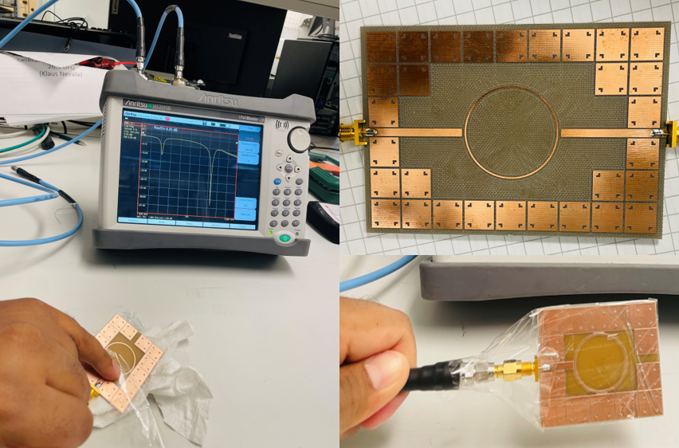
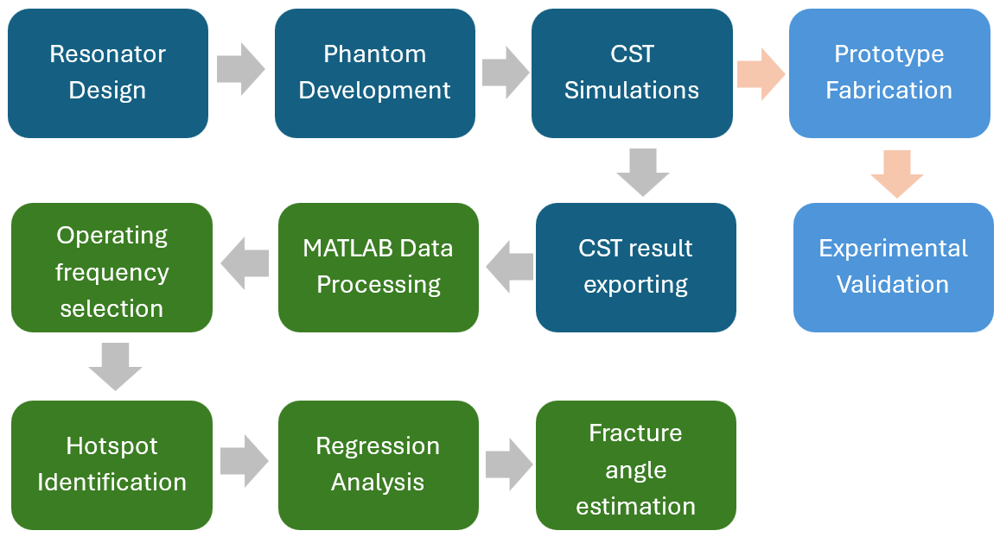
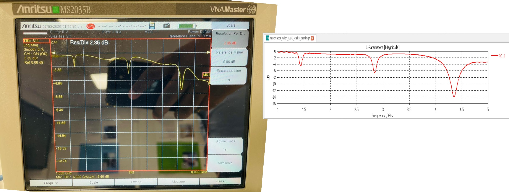
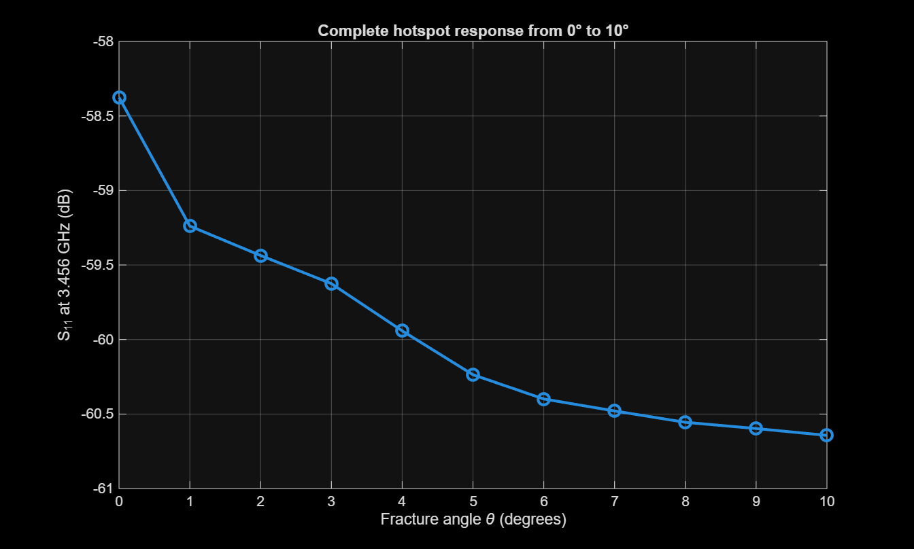

# FractureSense — Microwave-Based Bone Fracture Monitoring

## Overview

FractureSense is an ongoing research project exploring microwave-based sensing for non-invasive monitoring of changes in bone fracture angles. The project investigates whether changes in the electromagnetic response of a microwave resonator can provide useful information about fracture-angle variations.

The research is being conducted as part of my MSc in Biomedical Engineering at the University of Oulu, Finland, under the Centre for Wireless Communications (CWC).

## Resonator Prototype

The project involves designing and investigating a compact microwave resonator for potential use in fracture monitoring.

  

  <em>Physical resonator prototype and measurement setup investigated during the project.</em>

## CST Resonator Model

Electromagnetic simulations are used to investigate the resonator design and its interaction with the surrounding phantom geometry.

  

  <em>CST Studio Suite model of the microwave resonator and phantom geometry.</em>

## Problem Statement

Monitoring bone alignment during fracture healing can be challenging when the injured area is immobilised in a cast. X-ray imaging is commonly used to assess fracture alignment, but repeated imaging involves exposure to ionising radiation.

FractureSense explores microwave-based sensing as a potential complementary approach for monitoring changes in fracture alignment between clinical imaging assessments, without additional ionising radiation from the sensing process.

## Project Objectives

- Design and optimise a compact microwave resonator for fracture monitoring.
- Investigate electromagnetic interactions between the resonator and surrounding tissue-equivalent structures.
- Analyse reflection coefficient (S11) responses across different fracture-angle configurations.
- Investigate sensitivity to fracture-angle changes and sensor position.
- Explore practical fabrication methods for anatomically relevant, tissue-equivalent phantoms.
- Investigate the feasibility of estimating fracture-angle changes from microwave measurement data.

## Methodology

The research workflow includes resonator design, electromagnetic simulation, phantom development, prototyping, measurement, and data analysis.

  

  <em>Research workflow for resonator development, simulation, measurement, and fracture-angle analysis.</em>

### 1. Resonator Design and Electromagnetic Simulation

CST Studio Suite is used to design and optimise the microwave resonator and investigate its electromagnetic response.

### 2. Phantom Development

Suitable fabrication methods and tissue-equivalent materials are being investigated for future experiments involving controlled fracture-angle configurations.

### 3. Prototype Fabrication and Measurement

Physical resonator prototypes and measurement setups are used to investigate the resonator response. Experimental results are compared with simulation results where the configurations are comparable.

### 4. MATLAB-Based Data Analysis

MATLAB is used to process simulation data, analyse S11 responses, visualise spatial sensitivity, and investigate frequency selection for fracture-angle analysis.

### 5. Hotspot Identification and Angle Estimation

Candidate sensitive regions and frequencies are investigated to determine whether the measured response contains useful information about fracture-angle variations. Regression-based estimation remains subject to further evaluation and validation.

## Simulation and Measurement Results

### Experimental and Simulated S11 Response

  

  <em>Experimental and simulated S11 responses. The relevant resonances and configurations require consistent interpretation when comparing the two results.</em>

### MATLAB Hotspot Response Analysis

  

  <em>Illustrative S11 response at 3.456 GHz across simulated fracture-angle configurations from 0° to 10°.</em>

The plotted response shows a change in S11 across the investigated angle configurations. Further analysis is needed to establish sensitivity, repeatability, and the reliability of any fracture-angle estimation method.

## Methods and Tools

- **CST Studio Suite:** Electromagnetic modelling, resonator optimisation, and simulation.
- **MATLAB:** S11 data processing, spatial sensitivity analysis, and visualisation.
- **Microwave measurements:** Investigation of resonator responses using measurement equipment.
- **Resonator prototyping:** Development and testing of physical resonator designs.
- **Phantom fabrication research:** Investigation of tissue-equivalent materials and fabrication methods.

## Current Status

FractureSense is an ongoing research project. Current work includes resonator optimisation, simulation-based sensitivity analysis, investigation of experimental measurement results, and evaluation of practical phantom fabrication methods.

Further experimental validation is required to determine the feasibility and limitations of microwave-based fracture-angle monitoring.

## Future Work

- Refine the resonator design and operating-frequency selection.
- Develop suitable tissue-equivalent phantoms with controlled fracture-angle variations.
- Conduct systematic experimental measurements.
- Compare simulation and experimental results under comparable conditions.
- Evaluate sensitivity, repeatability, and regression-based angle estimation.
- Investigate the potential and limitations of the approach for future fracture-monitoring applications.

## Technologies

CST Studio Suite · MATLAB · Microwave Sensing · Electromagnetic Simulation · Resonator Design · S11 Analysis · Biomedical Engineering

## Author

**Mahela Ranasinghe**  
MSc Biomedical Engineering, University of Oulu, Finland

- GitHub: [SLMAHELA](https://github.com/SLMAHELA)
- LinkedIn: [Mahela Ranasinghe](https://www.linkedin.com/in/mahela-ranasinghe)

## Disclaimer

FractureSense is a research project under development, not a clinically validated medical device. Its performance and suitability for clinical use have not been established.
